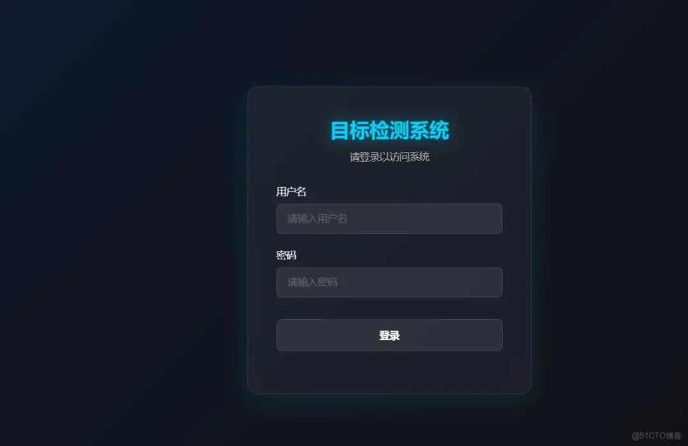
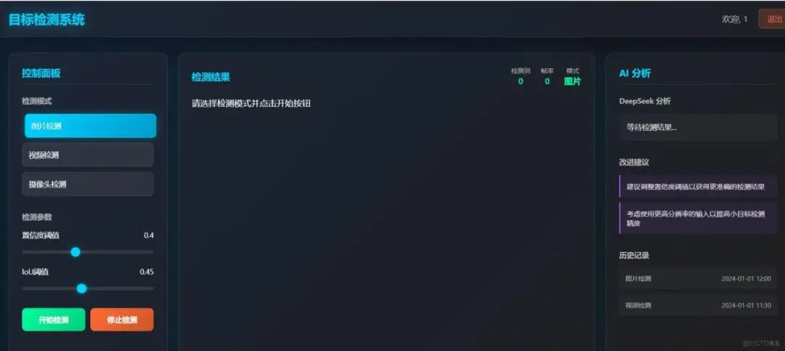
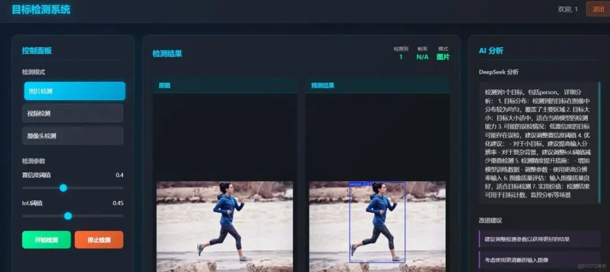

# Creating a beautifully crafted universal object detection system based on Yolo+Flask+DeepSeek, with a login interface supporting Yolov8, Yolov10, Yolov11, Yolov12, Yolov13, and the Yolov26 series frameworks.

YOLO General Object Detection Web System - A modern object detection web application system based on Flask and YOLO, supporting image

### YOLO General Object Detection Web System

A modern target detection Web application system based on Flask and YOLO, supporting real-time image, video, and camera detection, and providing access to deepseek AI intelligent analysis functions.

##### Designed Login Interface



##### Designed Detection Interface



##### Images Prediction Results



#### Project Overview

This system is a fully functional target detection platform that employs the latest YOLO model for real-time object detection, and combines modern web technologies to create an intuitive and user-friendly interface. The system supports various detection modes, provides detailed AI analysis, and features user authentication to ensure system security. It is a general-purpose target detection system that can be installed with the corresponding ultralytics module and replaced with the corresponding framework model, supporting YOLOv8, YOLOv11, YOLOv12, YOLOv13, YOLOv26, as well as any Ultralytics-improved framework.

##### Core Features

- **User Authentication System**

Flask-Login-based login system, ensuring system security.

- **Multimodal Detection**

 : 

-

Image upload detection

-

Video upload detection

-

Real-time detection of the camera

- **Parameter Configuration**

- Adjustable confidence threshold, IoU threshold, etc., for detection parameters

- **AI Intelligent Analysis**

: Provide detailed analysis and optimization suggestions for the detection results using DeepSeek API.

- **Modern interface**

- Dark Tech Theme Design, Responsive Layout, Sleek User Experience

- **Real-time reasoning**

Low-latency real-time detection in video and camera modes

- **Two-column display**

Left side displays the original image, right side displays the detection results, with clear and intuitive comparison.

#### Technology Stack

- **Backend**

 : Flask, Python, OpenCV

- **Frontend**

 : HTML5, CSS3, JavaScript, Canvas API

- **AI Model**

 : YOLO11 (Ultralytics)

- **AI Analysis**

 : DeepSeek API

- **Certification**

 : Flask-Login

- **Image Processing**

 : Pillow, NumPy

- **Deployment**

 : Python 3.8+

#### Quick Start

#### Environmental Requirements

-

Python 3.8 or higher

-

pip package manager

-

Network connection (used for downloading models and using DeepSeek API)

#### Installation Steps

1. **Clone Project**

```
git clone <project address>
cd <project directory>
```

1. **Install Dependencies**

```
pip install -r requirements.txt
```

1. **Configure environment variables**

Create a `.env` file in the project root directory and add the following configuration:

```
# DeepSeek API Configuration
DEEPSEEK_API_KEY=your_deepseek_api_key
DEEPSEEK_API_URL=https://api.deepseek.com/v1/chat/completions
# Flask Configuration
SECRET_KEY=your_secret_key
```

>

Note: Please replace with your own DeepSeek API key and Flask key.

1. **Start the application**

```
python app.py
```

The application will run on http://127.0.0.1:5000/

##### Login System

-

Default login credentials:

-

Username: `admin`

-

Password: `password`

#### Image detection

1.

Select "Image Detection" mode on the main interface.

1.

Click the "Upload Image" button to select a local image.

1.

The system will automatically process and display the results on the right side.

1.

View AI analysis results for detailed analysis.

#### Video Detection

1.

Select "Video Detection" mode on the main interface.

1.

Click the "Upload Video" button to select a local video file.

1.

The system will automatically process and display the results on the right side.

1.

The video will automatically play and perform real-time target detection.

# Camera Detection

1.

Select "Camera Detection" mode on the main interface.

1.

Click the "Start Detection" button

1.

The system will access your camera and display the detection results in real-time.

1.

Click the "Stop Detection" button to end the detection.

##### Parameter adjustment

In the parameter control panel on the right side of the interface, you can adjust:

- **Confidence threshold**

Control the credibility of the detection results (0-1)

- **IoU threshold**

Controlling the merging strategy of overlapping boxes (0-1)

#### API Documentation

##### Core API endpoints

### 1. Login API

- **URL**

 :  `/login`

- **Method**

 : POST

- **Parameters**

 :  `username` ,  `password`

- **Return**

Login status and redirection

###### 2. Detection API

- **URL**

 :  `/detect`

- **Method**

 : POST

- **Parameters**

`file`, `confidence`, `iou`

- **Return**

Detection results, annotation images, AI analysis

### 3. Real-time frame detection API

- **URL**

 :  `/detect_frame`

- **Method**

 : POST

- **Parameters**

`frame` (Base64 encoded image), `confidence`, `iou`

- **Return**

- Detection results, annotation frames

### 4. Analyze API

- **URL**

 :  `/analyze`

- **Method**

 : POST

- **Parameters**

`detections` (result of detection) and `mode` (detection mode)

- **Return**

AI analysis results

#### Project Structure

```
.
├── app.py  # Main application file, contains all routes and core logic
├── requirements.txt  # Dependency package list
├── templates/
├── index.html # Main Interface Template
├── login.html # Login page template
└── base.html # Basic template
├── static/
└── css/  # Stylesheet File
├── models/ # Model storage directory
└── README.md  # Project Documentation
```

#### Core Modules in-depth explanation

##### 1. Object Detection Module

Use the YOLOv8 model for object detection, supporting multiple input types:

```
def detect_objects(image, confidence=0.25, iou=0.45):
"""Detect targets using the YOLOv8 model"""
# Load model
    model = YOLO('yolov8n.pt')
# Execution of detection
    results = model(image, conf=confidence, iou=iou)
# Processing results
    return results
```

##### 2. Real-time Processing Module

Real-time processing of video and camera streams:

```
@app.route('/detect_frame', methods=['POST'])
def detect_frame():
"""Processing real-time frame detection"""
# Decoding Base64 Frames
# Execution of detection
# Generate Annotation Frame
# Return Result
```

##### 3. AI Analysis Module

Smart analysis of detection results using DeepSeek API:

```
def analyze_detections(detections, mode):
"""Analysis of detection results"""
# Construct Analysis Hints
# Call DeepSeek API
# Process and analyze the results
    return analysis
```

#### Performance Optimization

#### Front-end Optimization

-

Use Canvas to draw detection results, reducing DOM operations

-

Optimize image transmission, use appropriate compression ratios.

-

Implement frame skipping mechanism to balance detection accuracy and speed.

#### Backend Optimization

-

Model loading optimization, avoid reloading.

-

Inferencing parameter tuning, adjust batch size according to hardware performance.

-

Asynchronously handle non-critical tasks to improve response time.

#### Troubleshooting

#### Common Issues

1. **Video detection is not working**

-

Check if the video format is supported (recommended to use MP4 format).

-

Confirm if the browser supports video playback.

1. **Camera Unable to Access**

-

Check browser permission settings to ensure access to the camera is allowed.

-

Confirm that the camera device is functioning properly.

1. **Inaccurate test results**

-

Adjust the confidence and IoU thresholds.

-

Consider using a more suitable model for specific scenarios.

1. **Slow system operation**

-

Reduce video resolution

-

Increase the confidence threshold, reduce the number of detections

-

Consider using more powerful hardware

#### Safety Precautions

-

The system defaults to weak passwords. In production environments, please change to strong passwords.

-

Recommend enabling HTTPS in the production environment.

-

Limit the size of uploaded files


## Payment

Here is a pay link on Stripe ( https://buy.stripe.com/3cs8yP7sY87d0vu9AB ). Please contact me lonlonago@foxmail.com after funding $89, and I will send you a complete data files , thank you!


